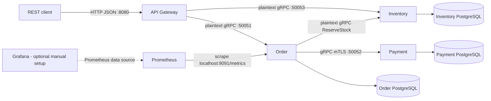

# Архитектура grpc-course

Инструкции запуска находятся в [руководстве локальной разработки](local-development.md),
REST-примеры — в [руководстве по API](api.md),
HTTP-контракт — в [OpenAPI](../api/openapi.yaml).

## Компоненты и соединения



Grafana-стрелка обозначает опциональное ручное подключение: provisioning и
дашбордов в репозитории нет. Адреса указаны для локального запуска.
Приложения не создают базы и не запускают миграции автоматически.

| Компонент | Точка входа | Ответственность |
| --- | --- | --- |
| API Gateway | `cmd/api-gateway/main.go` | HTTP-маршруты, JSON DTO, gRPC-клиенты Order/Inventory, преобразование кодов ошибок |
| Order | `cmd/order-server/main.go` | Проверка заказа, последовательная оркестрация Inventory → Order DB → Payment, метрики |
| Inventory | `cmd/inventory-server/main.go` | Создание/получение товара и резервирование остатка |
| Payment | `cmd/payment-server/main.go` | Создание или возврат сохранённой записи о платеже по order_id |

Gateway не обращается напрямую к PostgreSQL и Payment. Payment не списывает
реальные деньги: внешнего платёжного провайдера нет.

## Слои и расположение кода

Для Order, Inventory и Payment используется структура `internal/<service>/`:

- `domain/` — сущности, проверки инвариантов и ошибки. Часть интерфейсов
  репозиториев расположена здесь; InventoryRepository определён в application.
- `application/` — сценарии использования и необходимые им интерфейсы
  зависимостей. `OrderService` использует репозиторий, PaymentGateway,
  InventoryClient, logger и OrderMetrics.
- `adapters/grpc/` — серверные protobuf/gRPC-адаптеры и преобразование ошибок.
- `adapters/postgres/` — SQL-реализации репозиториев через `database/sql`, pgx
  и Squirrel. У Order также есть клиенты `inventorygrpc/`, `paymentgrpc/`
  и адаптер `metrics/`.

Gateway находится в `internal/gateway/http/`. Он не имеет собственного domain
и базы. Связывание зависимостей выполняется в `cmd/`. Контракты находятся в
`proto/`, сгенерированные Go-типы и сервисы — в `gen/`.
SQL-схемы и изменения хранятся в `migrations/{orders,inventory,payments}/`.

## HTTP-запрос через Gateway

`RegisterRoutes` регистрирует POST заказа, POST товара и GET товара. Отдельно
в `cmd/api-gateway` зарегистрирован `GET /health`; он отвечает `OK` без проверки
зависимостей. JSON декодируется через `encoding/json/v2` с запретом неизвестных
полей, преобразуется в protobuf и передаётся в gRPC с контекстом HTTP-запроса.

Gateway устанавливает соединения с Order на `localhost:50051` и Inventory на
`localhost:50053`; адреса фиксированы в точке входа. Собственного таймаута для
этих вызовов Gateway не задаёт. gRPC-код ошибки становится HTTP-статусом:
InvalidArgument → 400, NotFound → 404, AlreadyExists/FailedPrecondition → 409,
Unavailable → 503, DeadlineExceeded → 504, остальные → 500. В HTTP передаётся
фиксированное сообщение операции, без details/field violations сервиса.

При создании товара POST возвращает нормализованные поля, а GET использует ID
как передан. Поле `product_name` в ответе GET содержит название, полученное
из Inventory через `GetProductName()`.

## Создание заказа

```mermaid
sequenceDiagram
    autonumber
    participant C as REST client
    participant G as Gateway
    participant O as Order
    participant I as Inventory
    participant IDB as Inventory DB
    participant ODB as Order DB
    participant P as Payment
    participant PDB as Payment DB
    C->>G: POST /api/v1/orders
    G->>O: CreateOrder (plaintext gRPC)
    Note over O: Domain validation; exactly one item
    O->>I: ReserveStock(order_id, product_id, quantity), timeout 2s
    I->>IDB: BEGIN; INSERT reservation ON CONFLICT DO NOTHING
    alt New reservation
        I->>IDB: UPDATE stock = stock - quantity WHERE stock >= quantity
        Note over I,IDB: If update affects no rows: rollback and error
    else Reservation already exists
        I->>IDB: SELECT existing product_id, quantity
        Note over I,IDB: Same parameters: no second decrement; different: error
    end
    I->>IDB: COMMIT on success
    I-->>O: Reserved = true
    O->>ODB: BEGIN; INSERT orders and order_items
    alt Order already exists
        ODB-->>O: Unique violation; ROLLBACK
        O-->>G: AlreadyExists
        G-->>C: 409 Conflict
    else New order
        O->>ODB: COMMIT
        O->>P: CreatePayment over mTLS, timeout 2s (retry + circuit breaker)
        P->>PDB: SELECT payment by order_id
        alt Payment already exists
            PDB-->>P: Existing payment
        else Payment absent
            P->>PDB: INSERT payment with generated ID
            Note over P,PDB: Concurrent duplicate: SELECT existing payment
        end
        P-->>O: Payment
        O->>O: Increment orders_created_total
        O-->>G: CreateOrderResponse(id)
        G-->>C: 201 Created
    end
```

Диаграмма показывает успешный путь и точный повтор заказа; при любой ошибке
шагов резервирования/сохранения/платежа выполнение прекращается и ошибка
возвращается через адаптеры. COMMIT относится только к успешной ветви операции.
После ошибки Payment заказ и резерв уже могут существовать.

В Order сначала проверяется domain-модель и ровно одна позиция. Затем
резервируется товар; только после этого Order сохраняет заказ с позициями
в одной локальной транзакции. Общая сумма вычисляется как quantity ×
unit_price_minor из запроса. Цена Inventory не запрашивается и не сверяется.
Валюте достаточно быть непустой; нулевая цена заказа допустима.

ReserveStock и CreatePayment имеют отдельные контексты с таймаутом 2 секунды.
У Payment-клиента настроены retry для Unavailable/ResourceExhausted
(`WithMax(3)`, линейный backoff 200 мс) и gobreaker. Circuit breaker открывается
после трёх последовательных transient-сбоев; DeadlineExceeded также считается
сбоем breaker. Эти механизмы не являются распределённой транзакцией.

## PostgreSQL и резервирование

Базы принадлежат сервисам: Order использует `orders`, `order_items`, Inventory —
`inventory`, `inventory_reservations`, Payment — `payments`. Нельзя связывать
таблицы разных сервисов внешними ключами; таких межбазовых связей в коде нет.
Параметры подключения обязательны: `ORDER_DATABASE_URL`,
`INVENTORY_DATABASE_URL`, `PAYMENT_DATABASE_URL`; при старте выполняется Ping
с таймаутом 5 секунд. Паролей и fallback DSN в исходниках нет.

`InventoryRepository.ReserveStock` выполняет в одной PostgreSQL-транзакции:

1. Вставку `inventory_reservations` с уникальным `order_id` и внешним ключом
   на `inventory.product_id`; при конфликте order_id вставка ничего не меняет.
2. Если резерв уже существует, чтение product_id/quantity. Совпадение означает
   успешный повтор без списания; отличие означает ErrReservationConflict.
3. Для нового резерва условное уменьшение stock только при `stock >= quantity`.
   Если строка не обновлена, возвращается ErrInsufficientStock, транзакция
   откатывается вместе со вставленным резервом. Это предотвращает отрицательный
   остаток при конкурирующих обновлениях.
4. COMMIT для успешного резерва.

Остаток уменьшается сразу, отдельного состояния «зарезервировано, но ещё не
списано» нет. Нет API отмены/освобождения резерва или его TTL. Несуществующий
product_id может дать ошибку внешнего ключа при INSERT резерва; сейчас она
попадает в общий Internal, а не в NotFound.

## gRPC и mTLS

Protobuf определяет типы, unary-вызовы и дополнительные демонстрационные streaming RPC.
`WatchOrder` выдаёт демонстрационные created/paid и не читает состояние заказа
из БД; это не механизм наблюдения за реальной оплатой.

Order доверяет `certs/ca.crt`, предъявляет `order-client.crt/key` и проверяет
серверное имя из `PAYMENT_TLS_SERVER_NAME` (по умолчанию `localhost`,
в Compose — `payment`). Payment загружает `payment-server.crt/key` и
использует `RequireAndVerifyClientCert` с тем же CA. При изменении имени сервера
соответствующий SAN должен присутствовать в сертификате. Приватный ключ CA для выполнения
сервисов не используется и не должен распространяться вместе с ними.

Gateway HTTP и другие gRPC-соединения без TLS/аутентификации. Существующее
состояние рассчитано на локальный запуск; mTLS не защищает всю систему.

## Идемпотентность и распределённые ограничения

- Inventory обеспечивает идемпотентный эффект резерва только для одинаковой
  тройки order_id/product_id/quantity. Ключ резерва — один order_id, поэтому
  несколько разных позиций одного заказа не поддерживаются.
- Order не возвращает сохранённый результат повторного запроса: после успешного
  повторного ReserveStock вставка orders получает unique violation и даёт 409.
  В нормальном точном повторе остаток не уменьшается второй раз. Это не гарантия
  идемпотентности для произвольного изменения запроса или несогласованных данных.
- Payment ищет существующий платёж по order_id; при конкурентной вставке
  перехватывает конфликт уникальности и читает существующую запись. Сумма и
  валюта повторного вызова не сверяются с сохранённым платежом.
- При ошибке сохранения заказа успешный резерв остаётся. При ошибке платежа
  остаются и заказ, и резерв. Повтор CreateOrder может вернуть 409 до вызова
  Payment, поэтому он не восстанавливает незавершённую оплату.
- Timeout/потеря ответа не доказывает, что операция не была зафиксирована в БД.
  Нет общей транзакции, outbox, saga, компенсации, фонового восстановления или
  гарантии exactly-once для полного сценария.

Гарантии идемпотентности отдельных операций не распространяются на весь
распределённый сценарий создания заказа.
